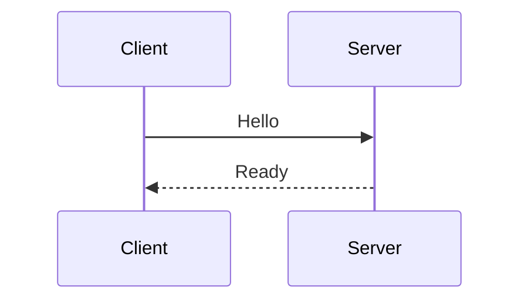

# The Markdown Crystalline understands

Engrams and reflections are plain Markdown. Crystalline adds a few small elements on top: callouts, status labels, math, task items, footnotes, colour swatches and diagrams. Each one reads sensibly as raw text, so nothing is lost in a plain editor or on GitHub. This page lists every element with its raw form, when it fits and how it reads without Crystalline. Agents get the same sheet in the `crystalline-presentation` skill.

> [!NOTE]
> An element earns its place when it does a job prose cannot. A page with no callout and no diagram is often the right page.

## Callouts

```markdown
> [!WARNING] Data loss
> Export the tenant first. The purge deletes every backup too.
```

A callout is a quote whose first line is `[!KIND]`. The kind is one of NOTE, TIP, IMPORTANT, WARNING, CAUTION and DETAILS, in any letter case. The title after the kind is optional. Without it the title is the kind's word. An unknown kind such as `[!DANGER]` stays a plain quote and lint Q007 names it.

When it fits: a risk, a prerequisite, a shortcut or background that the reader should not miss. Use one or two per page.

On GitHub: the five kinds without a title render as GitHub alerts. A callout with a title, and DETAILS, fall back to a plain quote. The text stays readable.

## Folding

```markdown
> [!DETAILS]- Rollback steps
> 1. Stop the service.
> 2. Restore the last backup.

> [!NOTE]+ Background
> This one starts open.
```

A sign right after `]` folds the callout: `-` starts it closed and `+` starts it open. `> [!DETAILS]` without a sign starts closed. Every other kind without a sign does not fold.

When it fits: long reference detail or optional steps. Never fold a warning or a caution.

On GitHub: a plain quote with the marker as its first line.

## Status labels

```markdown
The rollout is :status[In review]{blue}.
```

A small coloured label in a sentence or a table cell. The colour is exactly one of grey, blue, green, yellow, red and purple, in any letter case. Without `{...}` the label is grey. Any other colour renders grey too, and lint Q006 names the palette. A label with no text stays plain text. A label ends at its matching `]`, so `:status[a [b] c]` is one label. The label always carries a word, because colour alone is not a signal.

`:status[...]` is the only directive. Everything else that starts with a colon, such as `10:30` or `note:this`, is ordinary text.

When it fits: a verdict in a comparison table, or the state of a plan.

On GitHub: it reads as the text `:status[In review]{blue}`.

## Math

```markdown
Inline: $`a^2 + b^2`$ or $$a^2 + b^2$$ on one line.

$$
E = mc^2
$$
```

A formula can also sit in a fence with the language `math`. One formula per block. A single `$` is always a plain dollar sign, so prices like $5 are safe.

GitHub also reads a pair of single dollar signs as math, so a line with two dollar amounts may render as a formula there. Crystalline never does.

When it fits: a formula the reader has to read, not a number in a sentence.

On GitHub: it renders as math.

$$
a^2 + b^2 = c^2
$$

## Task lists

```markdown
- [ ] open
- [x] done
- [~] not applicable
```

`[~]` means the item does not apply. It is drawn struck through and never toggles.

On the reading page, anyone who may edit the page ticks a box. The click changes that one line. A reader without edit rights sees the box disabled, with the reason as its tooltip. A page open in an editor gets the tick live.

Task items are not observations, so `- [x] done` is never read as a category. Do not use them to record facts.

A tick alone is not feedback. On a Reflection page, a change that only ticks or unticks boxes does not become a feedback item in the `reflect` queue. That holds for boxes in numbered lists and inside a callout or quote too. A real edit next to a tick does, and so does a changed box inside a code block, which is text.

When it fits: things people act on and tick off.

On GitHub: `[ ]` and `[x]` render as checkboxes. `[~]` shows as literal text.

## Footnotes

```markdown
The limit is 50 requests a minute.[^1]

[^1]: Set by the gateway, not by the service.
```

Footnotes get small links in the text and a list under a hairline at the end. On a Reflection page, put the reference and its definition in the same `##` section, because Fluid shows one section at a time. A reference without a definition stays as its text.

When it fits: a caveat or a source that would break the flow of a sentence.

On GitHub: footnotes render as they do here.

## Colour swatches

```markdown
The brand blue is `#0969DA`.
```

Inline code that holds exactly one colour code and nothing else gets a small square of that colour before it. These forms work: `#0969DA`, `rgb(9, 105, 218)` and `hsl(212, 92%, 45%)`.

On GitHub: plain inline code (GitHub draws swatches only in issues, pull requests and discussions).

## Diagrams

````markdown

````

A `mermaid` fence draws a diagram in light, dark and print. Keep it small, about a dozen nodes, put a sentence before it that says what it shows, and quote a label that holds special characters: `A["Retry (3x)"]`. Do not set colours; the page does.

On GitHub: renders as a diagram.

## Code blocks

Every code block on the reading page has a Copy button at the top right. It shows on hover and on keyboard focus, and says "Copied" for two seconds. On touch screens it always shows.

On GitHub: code blocks look the same, without the button.

## On this page

A page with three or more `##` sections gets an outline of its `##` and `###` headings. There is no syntax. On a wide screen it sits in the right column and marks the section you are in. On a narrow screen it is a collapsed block above the text, and on a phone it sits in the drawer. On a Reflection page the outline lists the `##` sections only and sits in the threads column, or in the threads sheet on a narrow screen.

On GitHub: GitHub builds its own outline from the headings.

## Writing it in Fluid

The editor has one **Insert** menu with Callout (five kinds), Expand block, Status label, Diagram, Code block, Math and Footnote; Table and Task list have their own buttons. Type `/` at the start of an empty line to open every element at the caret, the table and the task list included, and filter it as you type. It does not open inside a quote or an HTML comment. Escape closes it, and so does a space right after the `/`; a query with no match closes it too. The `/` stays in the text.

While the caret is inside a callout, the toolbar offers the kind and "Starts open", "Starts closed" or "Does not fold". An expand block always folds, so it has no "Does not fold", and when it becomes another kind it keeps its `-` so it stays closed. Inside a status label it offers the six colours. Away from the active line, callouts, labels, swatches and math show as they do on the reading page.

## Rich paste

Paste rich text from a wiki, a web page or a word processor and Fluid turns the HTML into clean Markdown.

| From the other app | Becomes |
| --- | --- |
| Headings, emphasis, lists, task lists, code blocks | the same in Markdown |
| Tables | a table |
| Links | links |
| Images | a link; attach the file yourself |
| Info, note, tip and warning panels | callouts of the nearest kind |
| Expand sections | a folded DETAILS callout |
| Status lozenges | status labels in the nearest palette colour |
| Anything else | plain text, never HTML |

Links that are not safe, such as `javascript:` links, are dropped and their text stays. Use Mod-Shift-V to paste plain text instead.

## Lints

Crystalline checks these elements outside code fences and inline code.

| Code | Severity | Means |
| --- | --- | --- |
| Q006 | warning | An unknown status colour, as in `:status[Done]{orange}`. It renders grey. |
| Q007 | warning | An unknown callout kind, as in `> [!DANGER]`. It renders as a plain quote. |
| Q008 | info | An observation or relation inside a callout, for example `> - [fact] ...`. It is not indexed there, and the same holds inside any `>` quote. Keep them as top-level bullets. Engrams only. |

The findings show up in `crystalline verify` and on the receipts of `write_engram`, `edit_engram` and `write_reflection` as `markdown_findings`: a list of `{code, severity, message, line}`, present only when there is something to report. The agent fixes each finding at its line and writes again.
