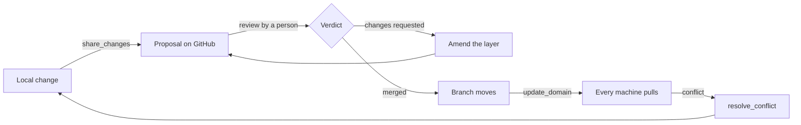
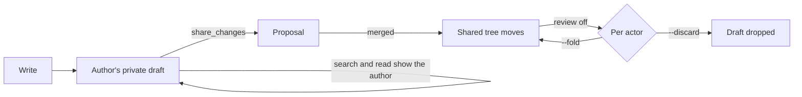

# Teams

A team shares knowledge through GitHub pull requests; this page is the whole lifecycle, from connecting a machine to review mode.

## Share knowledge with a team

A team domain is an ordinary domain whose files also live in a GitHub repository: local markdown stays the source of truth on this machine, and an origin records which repository, subfolder and branch it tracks.

Connect this machine to GitHub once:

```sh
crystalline config set github.enabled true
crystalline connect github
```

`connect github` opens a short code to confirm at github.com/login/device, or takes a personal access token via `--token` for someone who would rather skip the browser. Either way there is no git and no SSH key involved, since connecting only establishes this machine's GitHub identity. An agent does the same through the `configure` MCP tool, passing `connect: "github"` and relaying the code to the person at the keyboard.

Bring a team repository in as a domain:

```sh
crystalline domain add design --origin acme/design-knowledge
```

`--origin` takes `owner/repo` or `owner/repo/subpath` when the domain is a subfolder of a bigger repository. The local folder defaults to `<domains_root>/<name>` (the domains root is `~/Documents/Crystalline` unless you set `domains_root` or `CRYSTALLINE_DOMAINS_ROOT`), and the domain is downloaded and indexed immediately. An agent does the same with the `add_domain` MCP tool. Without `--branch` the domain tracks the repository's default branch, which is asked from GitHub once and written into the domain's entry.

From there, `crystalline origin` covers the team domain lifecycle:

- **`origin status [--domain <name>] [--files]`** - where a team domain stands: ahead (by change kind, so deletions never read as new notes), behind, open and declined proposals, unresolved conflicts, and which GitHub identity this machine reads and shares as. `--files` names the unshared paths under each domain instead of only counting them.
- **`origin update [--domain <name>]`** - bring a team domain (or every one) up to date with what the team has merged. When you and the team both changed a file, the two versions are merged: the frontmatter key by key (a key both sides set to the same value appears once) and the text below it line by line. What cannot be merged, or would leave a file that no longer parses, becomes a conflict for `origin resolve`.
- **`origin share <name> [--title <t>] [--message <m>] [--proposal [<n>]] [--direct] [--file <path>]`** - share local changes as a proposal the team reviews on GitHub. It refuses while a conflict is unresolved, so the team always reviews a clean proposal. Sharing again while a proposal is open stacks a new proposal on top of it, `--proposal <n>` amends that layer instead, a bare `--proposal` shares as a proposal on a domain that commits directly, `--direct` tries only the direct commit, and `--file` (repeatable) shares only the paths you name; on a domain whose MANIFEST declares `sharing: direct` the share commits straight to the branch instead.
- **`origin resolve <name> <path> --keep mine|theirs`** (or `--content-file <f>` for a hand-merged result) - settle a flagged conflict.
- **`origin withdraw <name> [--proposal <n>] [--revert]`** - close a proposal on GitHub and clear its record. Withdrawing a layer that is not the top one lifts its content out of the layers above and repairs the chain, and `--revert` also restores shared files that were not touched since sharing.
- **`origin diff <name> [--path <p>]`** - see what changed in each unshared file as a unified diff of the team's copy against yours, offline; `--path` narrows it to one file and `--json` returns both sides per file.
- **`origin discard <name> --path <p> [--path ...] [--yes]`** - put chosen unshared files back the way the team has them, offline: a modified engram gets the team's copy back, an added file is deleted, a deleted file is restored, and in a domain that reviews changes your own drafts of them are cleared. It previews first and asks; a file that changed since you looked is refused rather than overwritten, and nothing reaches GitHub.

From a local change to everyone's pull:



Where the forge serves stacked pull requests (github.com does, and Crystalline probes for it once per origin), a domain builds a stack rather than one long-running proposal: each share is its own focused review unit sitting on the one below, and reviewers merge bottom-up, so merging the top proposal lands the whole chain in a single click. Answering a review means amending the layer it belongs to (`--proposal <n>`, or `proposal` on the `share_changes` tool), which re-bases every layer above it automatically. Withdrawing a middle layer repairs the chain the same way, and a chain wedged by a declined layer heals on the next share or withdraw. On a forge without stacked pull requests, or with `github.stacks` turned off, a domain keeps a single living proposal that sharing updates in place instead: same number, same URL.

A share carries the domain's whole unshared delta by default, and can be narrowed to a subset of it: `--file <path>` on the CLI, repeated for several; a `files` array on the `share_changes` tool; per-file checkboxes in Fluid's share dialog. Where the domain shares its generated listings (see below), the `index.md` of each chosen file's own folder rides along so the repository stays browsable and no listing disagrees with the folder it describes, while a folder with nothing selected keeps its refresh for a later share. A path that is not among the domain's unshared changes refuses and names itself rather than being quietly dropped. Whatever you leave out simply stays an unshared local change. On an instance several people work in, Fluid's dialog opens with your own changes ticked, matched by the last writer each file's frontmatter records (a correctable heuristic rather than authorship enforcement, so anyone may tick or untick anything), and the line beneath the list counts what it left out, with unattributed changes and deletions counted as somebody else's. The share button carries the same count as a badge, its tooltip spelling it out as "2 of 5 unshared changes are yours" where that attribution exists. Be clear-eyed about what scoping is for on such an instance: a local edit is visible to everyone using the instance the moment it is written, because the working tree is what they all read, so choosing files decides what the team is asked to review on GitHub, not what colleagues can see. Before you share, both sides of every unshared file are one press away: in Fluid's share dialog a path opens a diff pane and a row's menu discards it, an engram page that differs from the team's copy wears an `Added` or `Changed` chip (`Draft` in a domain that reviews changes) whose menu shows the change, shares just that file or discards it, and `crystalline origin diff` and `origin discard` do the same from a terminal. Discarding never touches GitHub.

Whether those listings travel at all is the domain's own choice, declared once in the MANIFEST every member holds, as frontmatter rather than a section, since it is a switch and not a list:

```yaml
generated_indexes: shared
```

A folder's `index.md` is derived from the files beside it, so either answer is defensible and the domain picks one for everybody. `local` is the default, including for a MANIFEST that says nothing: the listings are generated on each machine and stay there, never travelling with a share, never counting as unshared work and never proposed in either direction. That is what a busy team wants, because two proposals touching the same folder both regenerate that folder's listing, and without this the second one conflicts the moment the first merges. `shared` is the deliberate opposite, and the choice to make when anything other than Crystalline reads the repository: the listings travel as ordinary files, every folder stays browsable on the forge, and the repository keeps the index files an OKF bundle is expected to carry. A value that is neither word is read as `local`, never as `shared`, and `crystalline verify` reports it as `M006`. An agent sees and changes this switch with `configure` and the domain: `configure` with `domain` lists every MANIFEST key with what it does, and `set` changes it.

A repository that already carries committed index files keeps them when its domain moves to `local`. A share proposes nothing about them in either direction, on purpose: a file sitting right there on disk is never something to offer to delete. Clear them out of the repository by hand if you want them gone.

Whether a share is reviewed at all is the domain's choice too, declared the same way:

```yaml
sharing: direct
```

`proposal` is the default, including for a MANIFEST that says nothing: every share opens a proposal the team reviews and merges on GitHub, exactly as before. `direct` commits the selected files straight onto the connected branch in one commit, authored by the identity the share goes out on (the sharer's own under `github.share_identity = personal`, the instance credential otherwise) - no branch of its own, no proposal - and is refused while one of your own proposals is open, since that proposal is waiting to land on the very branch. Files that only another person's open proposal changed stay out of your commit. Two shares are the exception: one that names your own open proposal amends it, and one made with `as_proposal` true (or after the branch refused a share, see below) stacks on your open proposal or amends it. A branch whose rules refuse your direct commits answers with the way out: share the same changes as a proposal (`as_proposal: true` on `share_changes`, or `crystalline origin share <name> --proposal`). From then on your shares try the direct commit first and open a proposal on their own when the branch refuses it; while one of your proposals is open, your share goes into that proposal. The refusal is kept for the GitHub login the share went out on. Under `github.share_identity = personal` each person shares as their own login, so one person's refusal never changes how another person shares. Under the default `instance` identity everyone shares as the instance, so they share one refusal too. While only someone else's proposal is open, a refused share opens no proposal and offers none, and `as_proposal: true` is refused the same way, because a share never goes into another person's proposal. Share again once that proposal is merged or closed. A `proposal` number that names another person's proposal is refused too. `origin status` says when your direct commits are refused, and a direct commit of yours that lands again ends it. A refusal means nothing on a domain that opens proposals: status does not show it there, and the next share clears it. The MANIFEST does not change, so the policy stays the team's. An account that cannot write the repository at all can make neither a commit nor a proposal, and the share says so. A value that is neither word is read as `proposal`, never as `direct`, and `crystalline verify` reports it as `M007`. The policy is read from the MANIFEST at share time, off the domain's own folder, not cached from an earlier read. A policy change that a share pulls in applies to the next share. Both switches sit on the domain page in Fluid as the "Domain policies" card, where the domain's owner changes them without opening the editor. An agent sees and changes `sharing` the same way, with `configure` and the domain. The same call lists what each MANIFEST section does and sets the domain's rule overrides in `.crystalline.yaml`. `token_budget` must be a positive whole number, and 0 is refused. Two rules read it: verify's `Q002` and the evolve sweep's `V105`. `rules.Q002: off` turns `Q002` off.

By default every share, amend and withdrawal goes out on the one GitHub credential this machine is connected with. Set `github.share_identity` to `personal` and each of those writes goes out on the identity of the person doing it instead: proposals carry their GitHub name, so an approval is never an approval of your own identity's work, while pulls and every other read stay on the instance credential. Each person connects once, on the surface they share from: Fluid's profile card under GitHub identity for shares made in Fluid, or `crystalline connect github --personal` for the machine owner's shares from the CLI and locally attached agents (`--token <PAT>` skips the browser sign-in, and an admin sets up a bot account with `--as <account>`). Until they do, sharing and withdrawing refuse with that instruction instead of falling back to the instance credential. An agent reaching the instance over HTTP MCP shares as the account it authenticated as, so where agents authenticate (`auth.mcp`) each agent's proposals carry the name of the person whose token it holds. Where they do not, the agent belongs to nobody, so it shares as the account `github.agent_identity` names (usually that bot) and its shares are refused while the setting is unset. Personal mode asks one thing of the repository: every sharer needs write access to it, since proposals are branches in the same repository and never forks, so a maintainer adds each person as a collaborator once.

The same actions are MCP tools an agent calls directly: `update_domain`, `origin_status`, `share_changes`, `resolve_conflict`, `withdraw_proposal` and `discard_changes`, plus `configure` for settings and connecting. Of these only `discard_changes` asks the person first, on a client that can ask. Its question has one checkbox that is already checked, so Accept undoes the changes and Decline keeps them. The other tools act on the call itself. Review feedback flows back through `update_domain`, which returns each open proposal's review state and the reviewers' comments, so the agent can refine the engrams and share again into the layer that feedback belongs to, or relay the commit on a direct domain. These six need `github.enabled` turned on: while it is off they are not listed at all, so an install that never uses team domains carries none of them in its context. Turning the setting on makes them appear (from the tool, from `crystalline config set` or from Fluid's Connect button, all the same), and a client subscribed to change notifications is told the list moved. The setting is one shared switch rather than a per-client one, so every client connected at any given moment sees the same list. A client holding a list cached from before the switch went off still gets taught rather than confused: calling one of the six answers with the reason and the `configure` call that turns collaboration back on. `add_domain` is not among them: it creates domains of every kind (local, virtual, team) and is always available, though its team-domain branch still needs `github.enabled`. Sharing always ends with the agent relaying a URL to the person it is working with. On a domain that opens proposals it relays the review URL and a person merges it on GitHub; on a direct domain it relays the commit URL and nothing waits for a merge.

`crystalline config show`, `set <key> <value>` and `unset <key>` read and write the settings registry: `domains_root` plus the `github.*`, `service.*`, `skills.*`, `database.*`, `auth.*` and `search.*` blocks and the rest. The `configure` MCP tool shows and changes the same registry without the operator settings (the network, the database and sign-in), which only the CLI changes. Every settings key also maps to a `CRYSTALLINE_*` environment variable, so a container never needs to mount this file at all. See [Configure through environment variables](deployment.md#configure-through-environment-variables) for the full list. A domain's origin and the global `github` block look like this in `config.yaml`:

```yaml
domains:
  design:
    path: ~/Documents/Crystalline/design
    origin:
      repo: acme/design-knowledge   # the GitHub repository, owner/name
      path: knowledge               # optional subfolder; absent means the repository root
      branch: main                  # optional; domain add writes the repository's default branch here; absent means main
      poll_secs: 600                # optional per-domain poll interval override
github:
  enabled: true                     # turns team domains on; absent means off
  stacks: true                      # stack each share on the open proposal where the forge supports it; absent means on
  share_identity: personal          # instance (default) shares on this machine's credential; personal shares on each person's own
  agent_identity: share-bot         # the account whose connected identity unauthenticated HTTP agents share as in personal mode; absent refuses those shares
  poll_secs: 300                    # background poll interval in seconds; minimum 60
  api_url: https://github.example.com/api/v3   # GitHub Enterprise Server only
  oauth_client_id: abc123                       # a self-hosted OAuth App, GitHub Enterprise Server only
```

### Read-only domains

`read_only: on` in a domain's MANIFEST stops every change made through Crystalline. Agents over MCP, people in Fluid, the CLI and the REST API all get the same answer: "'<domain>' is read-only; its owner switches read_only off in the domain policies". `off` is the default.

Only the domain's owner or an instance admin may switch it on. That holds on every path: the domain policies card, `PATCH /domains/{domain}/manifest`, the MANIFEST editor, `configure` and an edit of the MANIFEST through Crystalline. Anyone else gets "only the owner of '<domain>' or an instance admin may change `read_only`". This includes an agent on an instance that lets agents in without a token. On a local install the agent is the machine owner, so it may switch the flag on when you ask it to. A co-editing room never switches it on; use the policies card.

Switching it off is something a person does. Use the domain policies card in Fluid, `PATCH /domains/{domain}/manifest`, or edit `MANIFEST.md` outside Crystalline. Over MCP every way to switch it off is refused, for every caller, the machine owner included. The answer is "'<domain>' is read-only. Only a person switches it off, in the domain policies; ask the owner." Switching it off is the one change a read-only domain takes.

The flag guards Crystalline's own surfaces against accidental writes. It is not a sandbox. An agent with a shell can still edit `MANIFEST.md` on disk or run the CLI, and Crystalline cannot see who edits the file with a plain editor. Such an edit takes effect like any other MANIFEST key edited outside Crystalline, at the next write or sync, and nothing reports who made it.

On a team domain, switching it on here stays a local change, because sharing is refused while the flag holds. Switch it on in the team repository if the whole team should follow. The team repository stays the authority: `update_domain` keeps a read-only copy current, and when the team switches the key off upstream, the next update opens the domain here too. Discarding local changes and resolving a conflict with the team's side still work, because both bring the copy back to what the team has. Over MCP neither may touch `MANIFEST.md` while the flag holds, because the team's copy can switch it off. A person does that in Fluid or over REST.

The flag is shown everywhere. The routing block marks the domain "(read-only)", a domain row in `list_domains`, `browse_domain` and `read_engram` carries `read_only: true`, and Fluid shows a lock. The same mark also means "you cannot write here" for a reason that is yours, not the domain's: a viewer role, or a write list that leaves the domain out (see [An account per agent](deployment.md#an-account-per-agent)). The refusal sentence names the reason. Maintenance leaves a locked domain alone until the flag is off. A value other than `on` or `off` is read as `off`, and `crystalline verify` reports it as `M009`.

### Private domains

A domain does not have to be shared with the whole team to exist on a team instance. Make one private (from its Members card in Fluid, or `crystalline domain visibility <domain> private --owner <account>` from the CLI) and only its owner, the accounts invited into it and instance admins can see it at all. Everyone else gets the same answer a domain nobody registered gets. Be honest about what that protects: private is a wall between accounts, not from whoever operates the machine. The CLI, running on the host, administers every domain, invited or not, exactly the way a GitHub organization owner sees every repository in it. See [Private domains](deployment.md#private-domains) for membership levels and the full command set.

### Review mode

A domain can go a step further than shared: `review: overlay` turns its folder into reviewed truth, changed only by a merge that lands from GitHub, so the tree everyone reads stops moving the moment somebody saves. Every write in a domain like that (yours or an agent's) joins its author's own private draft instead of the file: search, read, `browse_domain`, `evolve_engrams` and the routing prompt all show your own drafts stitched into what the domain already shares, and nobody else's are visible to you. A `[[link]]` inside a draft still resolves against the shared tree only, never against another author's unshared words, so the graph an outsider walks never dead-ends into somebody's draft by accident. `share_changes` proposes exactly your own drafts, through the same review flow above. A receipt marked `draft` means the tree did not move, and only a merged proposal changes it. A reviewing domain also allows only one open proposal at a time, even where the instance's `github.stacks` setting is on: a second author's first share waits for the open one to merge, or is told to ask its author to withdraw it, rather than stacking a proposal beside it.

Turn review on with `crystalline domain review <name> overlay` (or Fluid's domain card, or the `CRYSTALLINE_DOMAIN_<NAME>_REVIEW` variable in [Configure through environment variables](deployment.md#configure-through-environment-variables)): it needs a GitHub origin, since review with nothing to propose into is a gate with no door, and a clean folder, refusing and naming the paths to share or revert first otherwise. Turn it off with `crystalline domain review <name> direct`, naming what happens to every actor's drafts (`--fold <actor>` writes theirs into the folder, `--discard <actor>` drops them), because disabling review ends every private draft in the domain, and the command prints that plan before it asks anyone to confirm it.

A write in a reviewing domain:



None of this needs a second person to be worth using. A one-person instance may put a domain in review mode too: with the agent authenticating as its own person, agent and person share the same draft and the same GitHub identity, so an owner-and-agent pair gates nothing extra by default. Review mode is simply the pause the owner already wanted before their own and their agent's work lands, made structural instead of a habit. Be honest about the one thing it does not stop: a file dropped straight into the folder by hand, outside any draft, still lands there (the folder is still the operator's), and `origin_status` names it under `out_of_band` rather than pretending review caught it.

A draft stays private to its author, with one deliberate door out: hand somebody a draft share-link (`dl_...`) and they pass it as `share_link` on `read_engram` or `edit_engram` to open that one draft of that one engram instead of a copy of their own. That is a grant scoped to a single page, revocable by the author, and the only way anyone but the author sees inside a draft before it is shared. Opening the same engram in Fluid, or reading it through a share-link, may land you in a live document instead: when somebody has that page open in the editor, an agent's read and its edits go through what they are looking at rather than the file behind it, landing under their cursor and naming the agent in the participant strip for a minute after each call (a colour chip over HTTP, "you (agent: <client>)" when the agent is a local stdio session acting as the machine owner). That holds only while their editor is saving: when its save is in conflict or was refused, or it is closing, an agent reads the saved version (with a note, while somebody still holds unsaved text there) and its edit goes to the file behind it, the receipt of an edit into a page that is still open says `landed: file` with a `room_note` the agent passes on, and the page takes the change in when it saves again. That holds from the CLI too: `crystalline write --overwrite` onto a page somebody has open lands in their live document rather than replacing the file behind the room, and is refused, naming who is in there, while that page is not saving, and a retirement (delete or supersede) composes into it the same quiet way, as does a moved engram's new address when the move rewrites a link on that page. A move that changes the page's address (a new permalink or another domain, from Fluid, an agent or the CLI, or a rename of the domain) is not refused while the page is open: the editor saves first, is closed and told the new address, and offers to open the page there with any text not saved yet. A move that keeps the permalink leaves the editor open. If the last person leaves a page whose save was refused or is still in conflict, the server keeps the page's text in its state folder (see [Kept texts](#kept-texts)). A wholesale replace through the agent tools is refused rather than landing over unsaved work, and the refusal names who is in there.

### Kept texts

When the last person leaves a page in the editor and its last save cannot land (the save was refused, or it is still in conflict), nothing would ever save that text again. The server keeps it as a file instead: `kept/<domain>/<engram|reflection>/<path>.<time>.md` in its state folder. This covers engrams and Reflection pages. A text from somebody's review draft goes to `kept/<domain>/draft/<owner>/...`, because a draft is private to its owner. On a shared database, a Reflection page write or a thread comment that was refused because its instance lost the domain's host lock while the write was on its way is kept the same way: a page under `kept/<domain>/reflection/`, a comment under `kept/<domain>/comment/<page>`. Such a text also records who sent it (the account and the name shown) in a file beside it, and `crystalline kept list` shows "sent by <name>". The server never deletes a kept text on its own, because it may be the last copy of somebody's work.

To get a text back:

- `crystalline kept list` shows every kept text with a short id, the domain, the page or engram, when it was kept, its size and the file. `--domain <name>` shows one domain, `--json` gives the same as data.
- `crystalline kept show <id>` prints the text as it was kept, so `crystalline kept show <id> > text.md` saves it. Copy what you need back into the page or the engram.
- `crystalline kept drop <id>` deletes it after you confirm. Without a terminal, or with `--json`, it needs `--yes`.

`crystalline status` shows `Kept texts: N (crystalline kept list)` while any are there, and `crystalline doctor` lists them and warns about one older than 30 days. `doctor --fix` never deletes them. These commands read the state folder of the machine they run on, so on a team server run them there (for a container, with `docker exec`). They show every kept text on that machine, every owner's draft texts included.

Over the JSON API, `GET /api/v1/domains/<name>/kept` lists a domain's kept texts, `GET .../kept/<id>` returns one with its text and `DELETE .../kept/<id>` drops it. A text goes only to a person who may write its source, with the right its editor needs: a Reflection page's text needs edit on the Reflection (curate for `PACT.md`), a kept comment goes to the account that sent it (an agent's comment to the account it acts for) and to everybody who edits the Reflection, and one with no recorded sender to editors only, and an engram's text needs write access to the engrams. Each entry carries `sender` (the name shown in threads, the login name for people) and `sender_account` (the account it was sent as, which the rights match) when the text was kept for a refused write, and `null` for both otherwise. A text from a review draft goes to the draft's owner only and is marked `draft`, so a draft owner who has lost write access to the engrams cannot reach it over the API any more (`crystalline kept` on the server still can). A person with none of these rights gets 403; a reader of the Reflection gets only the kept comments they sent. On a read-only instance the API lists and returns kept texts but refuses `DELETE` with 403; drop them with `crystalline kept drop` on the server. Agents have no tool for kept texts: a kept text is a person's unsaved typing, and the person decides what happens to it.

A page you edit in your review draft cannot be saved while its file is missing on this disk (deleted by hand, or not synced yet): restore or sync the file, and until then the editor's text is kept here when the editor closes. A rename moves a domain's kept texts with it. When a domain is removed, its kept texts move to `kept/.removed/<name>-<time>/` and are never deleted: a domain added later under the same name does not see them. `crystalline kept list` and `crystalline doctor` still show them, marked as from a removed domain. Texts left under a name no domain owns (for example from a removal on an older version) are moved aside the same way when a domain takes that name, by an add or a rename. A keep writes the text to a temporary file first; if the process stops in between, `crystalline kept list` and `crystalline doctor` show that file as an unfinished keep once it is more than a minute old, `crystalline kept show` prints it, and nothing deletes it.

### Stable domain names

A `[[link]]` or a `crystalline://domain/permalink` address carries a domain name inside its text, so the name a domain resolves under has to stay the same wherever the link travels. Two colleagues who each import the same team repository, one under its repo name and one under a name they typed themselves, read each other's links as pointing at some other domain, or at nothing at all. This bites at scale: a team with thirty-odd `<project>-knowledge` repositories, each meant to become a domain called `<project>`, breaks a link every time a colleague registers one under its repo name instead.

The fix is that a domain owns its own name. It declares it once, in its own MANIFEST:

```yaml
domain_name: design
```

That is the domain's canonical name everywhere: in every link, every `crystalline://` address, the web URL, the MCP and REST `domain` parameters, on every machine that has it registered, whatever any one machine happens to call it locally. For a local file domain or a virtual domain, Crystalline adds `domain_name` to the MANIFEST when the domain is registered (for a domain registered before 0.20.0, on its first sync after the upgrade). If that write fails, it says so and you add the line by hand; in a domain that reviews changes, the line waits in your draft until that draft is accepted. A domain defined by an environment variable is left alone. A team domain is different: Crystalline never writes `domain_name` into a team domain's MANIFEST on its own, at registration or later, because a write nobody asked for would sit as a pending change that blocks review mode and collides the moment the owner adds the name themselves. The owner adds `domain_name` to the repository, the same way any other MANIFEST field is added, and shares it like any other change.

`domain add` picks the local name in this order: a name given explicitly wins; failing that, the repository's own `domain_name`, if it already declares one; failing that, the repository name for a team domain or the folder name for a local one. A declared name that is already taken by another domain on this machine steps to `<name>-2`, and the new domain's canonical name is reported as shadowed: links naming it still reach the domain that already holds it, and `add` says so.

Once an owner adds or changes `domain_name` in a repository, every colleague's machine lines up on its own next sync. A machine whose local name was only ever a default, never chosen on purpose, is renamed to match automatically, and its old name keeps working afterward as an alias. A machine whose local name was chosen on purpose keeps it: the canonical name still resolves there, only the local name stays different. Either way, whatever name a link already carried keeps reaching the domain, so nothing already written breaks. An instance that shares its index with another live instance does not rename on its own; stop the other instance and run `crystalline domain rename <domain> <new> --local`.

The rollout for a team with many `<project>-knowledge` repositories already imported under their repo names: the owner adds `domain_name: <project>` to each MANIFEST and shares it. Every colleague whose registration only ever carried the repo-name default is renamed to `<project>` on their next sync, with nothing to do; anyone who had chosen a local name of their own keeps it, reachable under the new canonical name too. `crystalline doctor` lists whatever is still left afterward: a domain whose declared name collides with one already registered here, an adoption that has not gone through yet and why, and any team domain that still declares no `domain_name` at all.

Two domains on one machine never have names that differ only in letter case (`eng` and `Eng`): on a disk that ignores case they would share one state folder, so adding, renaming or connecting a domain under such a name is refused on every platform. Renaming a domain to its own name in other letter case is fine. An older install that already holds such a pair keeps working, and `crystalline doctor` warns about it and names the rename that ends it.

Rename a domain directly with `crystalline domain rename <domain> <new>`, or Rename domain on its domain page in Fluid: it sets `domain_name` in the MANIFEST, changes the local name, and rewrites every `[[old:x]]` link and `crystalline://old/...` address it can reach to the new name, in every domain you can write. In a team domain the rewrites become a pending local change to share; in a domain that reviews changes they land in your own draft. Every former name, local or canonical, keeps working afterward as an alias, so a link written before the rename still reaches the domain, and an old `/d/<old>/` address in Fluid redirects to the new one. `--local`, or "This machine only" in the Rename domain dialog, renames only this machine's own record and leaves the MANIFEST and every link exactly as they are; use it when the MANIFEST cannot be written here, which the command's refusal names.

A rename moves this machine's own state folders and writes its own configuration, so it runs only against this machine's own index and configuration. A `crystalline domain rename` with `--db` or `--config` naming anything else is refused before anything moves, and so is a rename sent to a daemon or an embedded MCP server started with such flags; neither of those lines names up with their MANIFESTs either. A rename that stops halfway (a crash, a killed process) keeps a journal in the state directory, and the daemon, or the next command run without `--db` and `--config`, finishes it. `crystalline doctor` shows such a journal under its own `rename:` heading, with the steps already done and the steps still to run. When the journal was recorded against another spelling of this machine's configuration or database (the configuration moved, or `database.url` was written differently since), nothing finishes it on its own: doctor says what to put back first (`CRYSTALLINE_CONFIG`, or `database.url` or `CRYSTALLINE_DATABASE_URL`) and then the command to run. A journal from a state directory that has moved cannot be finished from here. `crystalline doctor --discard-rename` drops a journal on request and leaves the steps it already ran as they are, half moved, for you to finish or undo by hand; `doctor --fix` never drops one.

`crystalline doctor` reports on domain names under its own `domain names:` heading. It names a domain whose declared name is shadowed by another domain already registered under it; two domains that both declare the same name, so links naming it reach neither; every team domain that declares no `domain_name` at all, one line each, asking you to have its owner add `domain_name` to the MANIFEST; and links in your own domains that still spell a domain by a name only this machine uses, which `doctor --fix` rewrites through the ordinary write path (a pending change in a team domain, a draft in one that reviews changes). `crystalline domain remove` clears the removed domain's own leftover row from the index as it unregisters it, so the name is free again for a rename or a fresh registration onto it; `crystalline doctor --fix` clears any such leftover row an older version of Crystalline left behind.

When a sync sees that the MANIFEST of a domain whose name you chose now declares another `domain_name` (a teammate changed it, or you did by hand), the domain keeps its name here and the old declared name keeps working as an alias. Doctor lists this under `domain names:` as a rename waiting for an answer, and counts it as a problem. `doctor --fix` finishes it: every link that still uses the old name gets the new one, in engrams and in Reflection pages, through the same write path as above. The domain's owner can also finish it from the banner on the domain in Fluid, or keep the links as they are there, which closes the question. A `crystalline domain rename` closes it too. Each instance asks once. When you finish it on a team domain, the rewritten links wait for your next share.

Offline, `crystalline verify` reports a `domain_name` that cannot name a domain as `M008`: written as something other than text, or text that fails the same validation `domain add` and `domain rename` apply. It is an error, and it is ignored at runtime rather than guessed at. The same check runs when a MANIFEST is written or edited, so the write or edit receipt lists it under `manifest_findings` right away. `crystalline evolve` flags a link that still spells a domain by a name only this machine uses as `V110`, the same finding `doctor` reports and `doctor --fix` rewrites. While a rename from a hand-edited `domain_name` waits for an answer, `V110` for the old name is judgment, so an agent leaves those links to you; after Keep links as they are, it no longer speaks about them. A rename question closes when you answer it, or when a pull brings files that removed the last old names; links respelled on this machine, by you or by an agent, never close it.

