# Diagram Gallery

One fence per diagram type, so the browser smoke can check that each one
renders in light, dark, on a phone and on paper.

## Flowchart

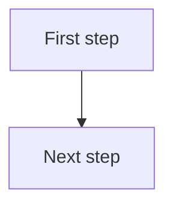

## Sequence

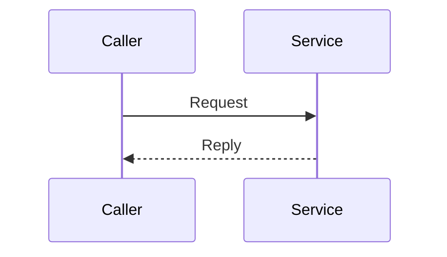

## State

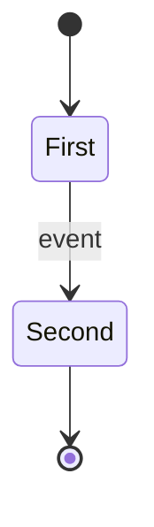

## Class

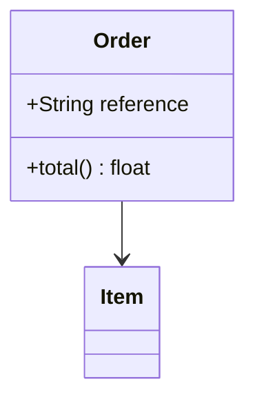

## Entity relationship

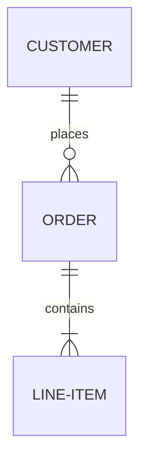

## Gantt

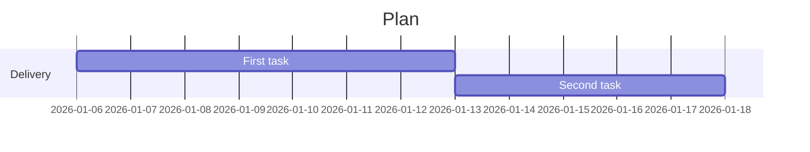

## Pie

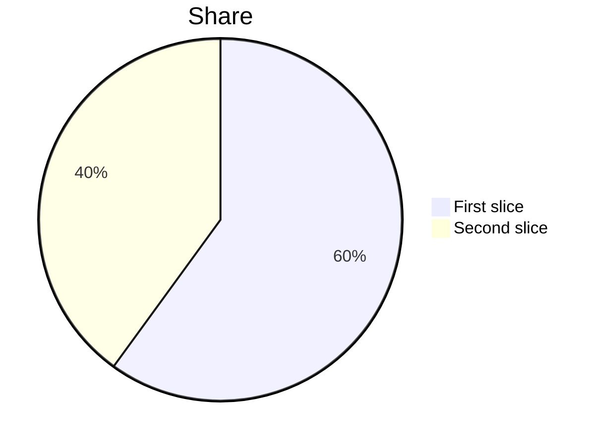

## Timeline

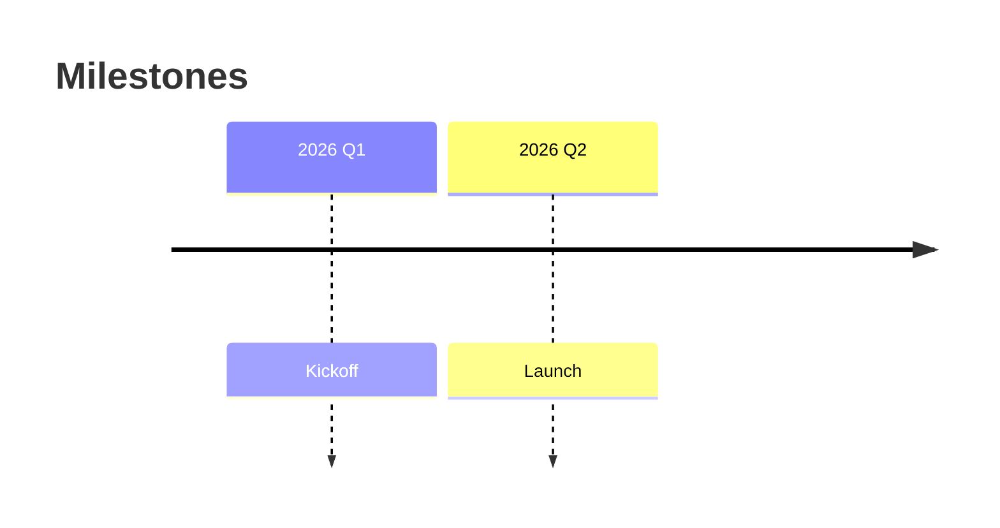

## User journey

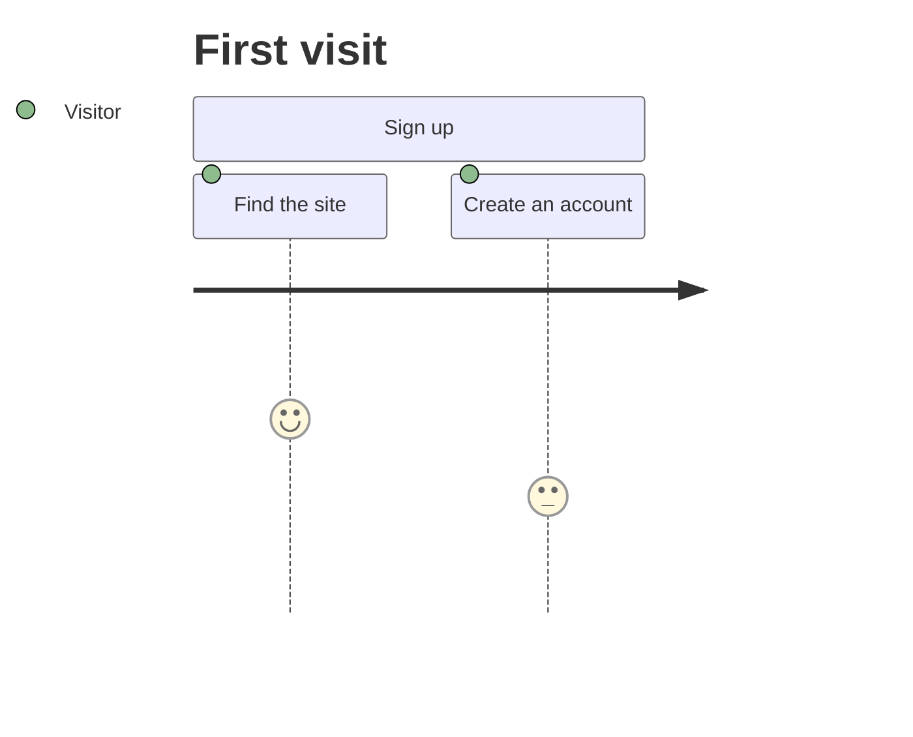

## Quadrant chart

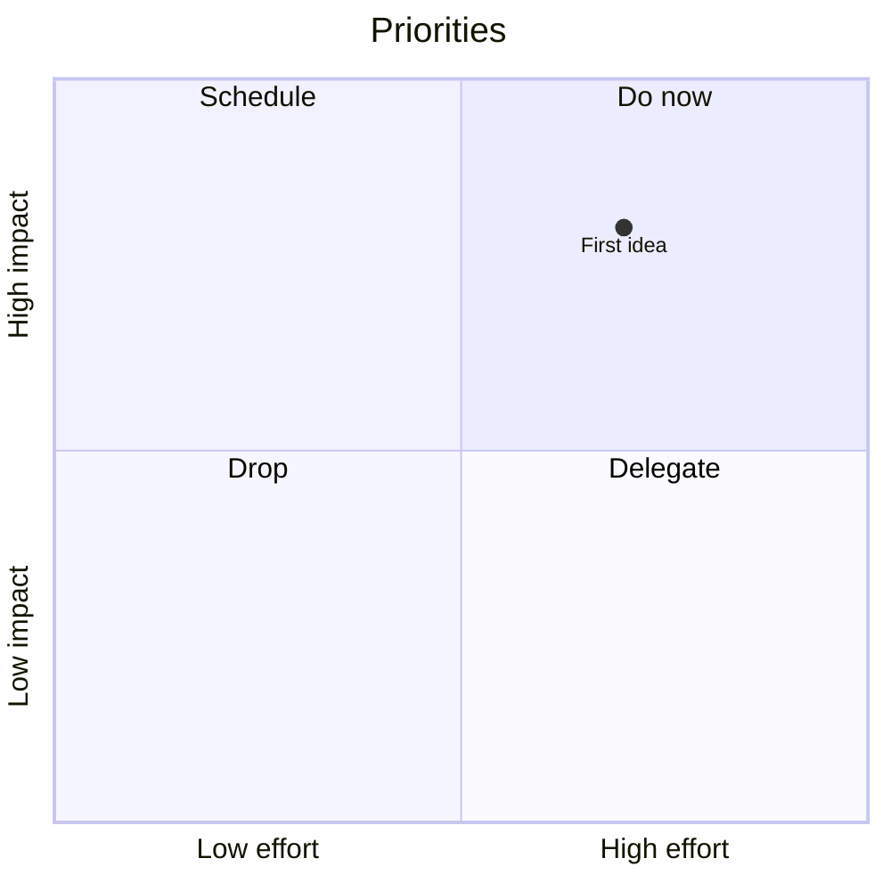

## Mindmap

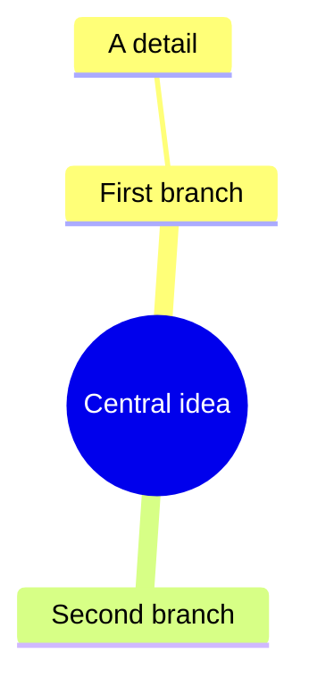

## C4 context

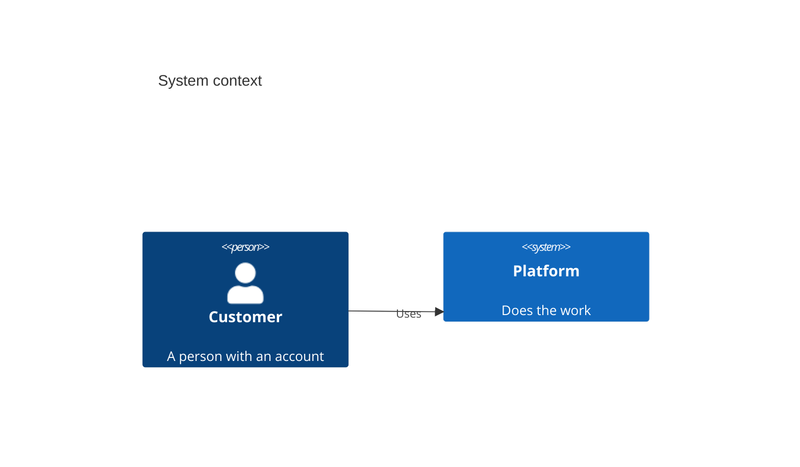

## Requirement

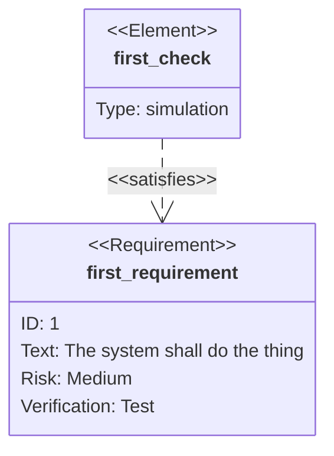

## Architecture

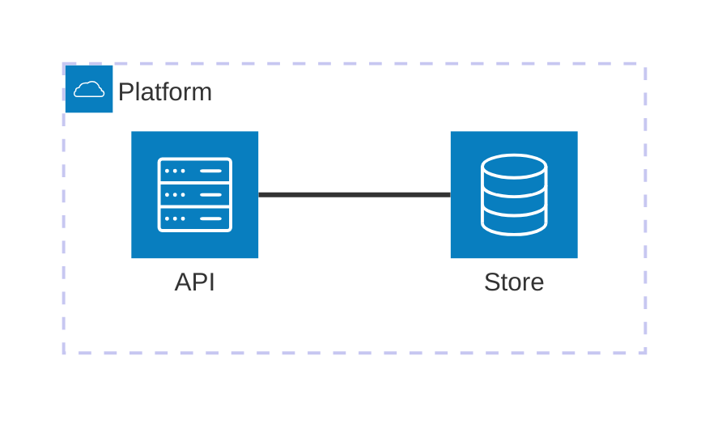

## XY chart

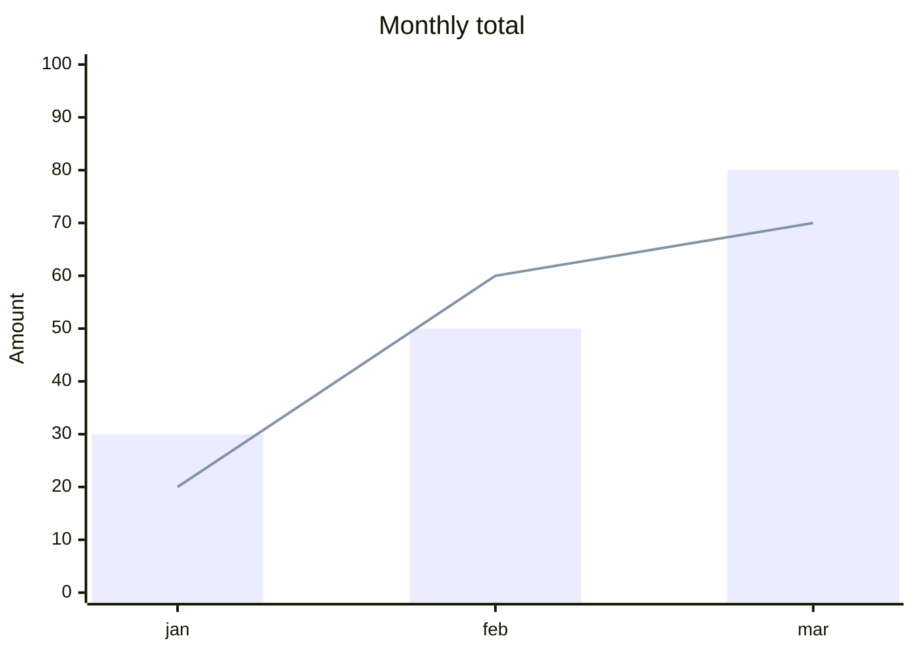

## Radar

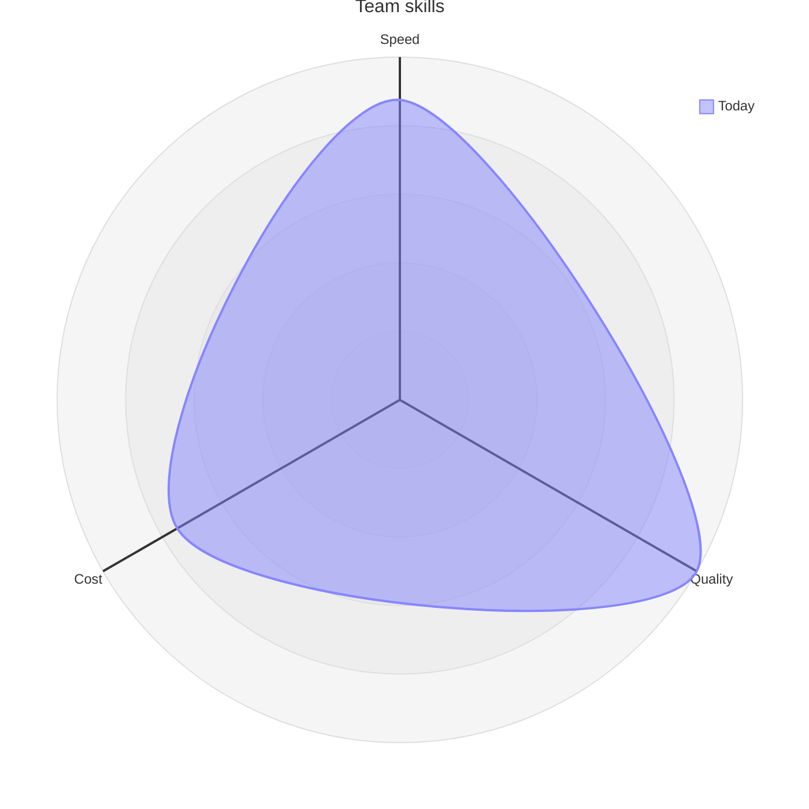

## Git graph

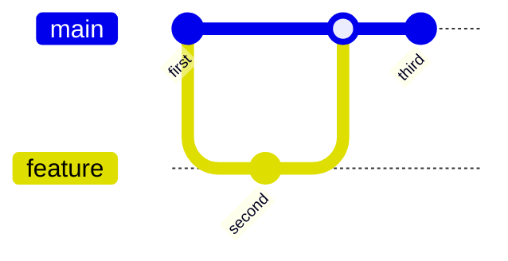
