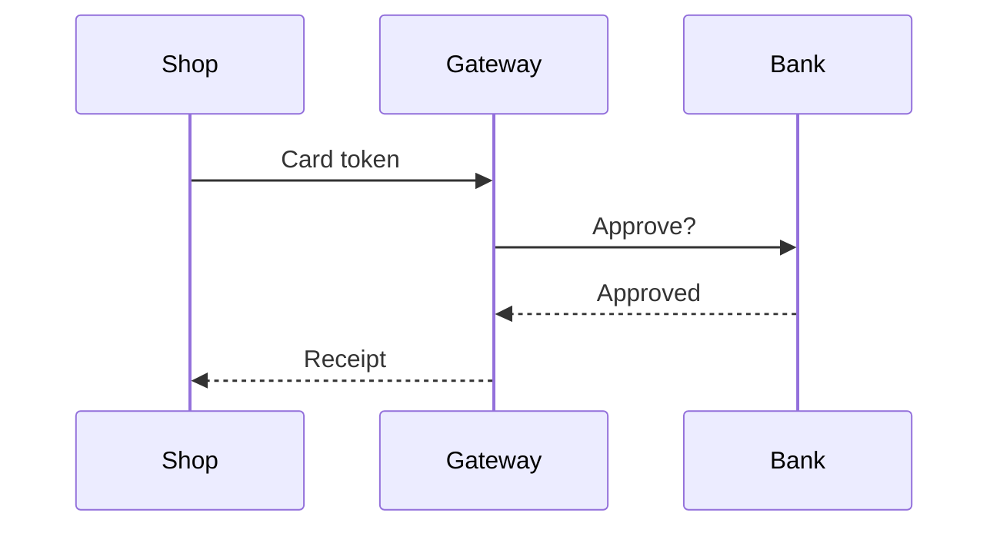

# Crystalline Presentation

A reflection is read by people. Present it the way a good technical writer would: clear prose first, and a diagram, callout, table or status label where the content calls for one. Engrams are read by agents and people, so the same elements may help there when they make knowledge easier to store, describe or find.

## When it applies

- You write or update a reflection, or `PACT.md`.
- You work a `reflect` queue: feedback items, update items and review items.
- You write or edit an engram where a table or a diagram would make it easier to find or to use.

## The PACT first

Before you write a page, read the domain's `PACT.md` with `read_reflection`. Its `## Presentation` section says which diagrams, callouts and tables help these readers and what to avoid. It narrows or extends the defaults in this skill, and where the two differ, the PACT wins. A PACT that says "no diagrams" means no diagrams, even where this skill requires one, and a PACT that asks for plain text and tables only means no callouts and no diagrams, not even a caution before an irreversible step: say the warning in a sentence.

When the PACT has no `## Presentation` section, use the defaults below. If you see a pattern the readers would want written down, propose it: write it into `PACT.md` when you may curate, otherwise open a thread with `discuss`.

When you rewrite a whole page, pass the `checksum` from `read_reflection` as `expected_checksum`, so a change a person made since your read is refused instead of overwritten.

Record the engrams each section was built from with `sources` on `write_reflection`, as permalinks in this domain or `crystalline://<domain>/<permalink>` addresses for another domain; never write them into the page as HTML comments or text.

## Where an element is required

These shapes need their element. A numbered list or a paragraph is not enough for them.

- **Messages or steps between two or more parties in a fixed order** (a client, a server, a third service): a `sequenceDiagram`. Always, even for three steps.
- **A process with a decision or a branch** ("if the check fails, ..."): a `flowchart`.
- **States and the moves between them** (draft, active, closed): a `stateDiagram-v2`.
- **Three or more options compared on the same attributes**: a table, one row per option. Not a bullet list, and not one `##` section per option. When the source gives a verdict, add a verdict column with status labels.
- **An action that cannot be undone, or a risky one**: a `> [!WARNING]` or `> [!CAUTION]` callout inside the section that describes that action, directly before or after the step. Never in the page lead (the text above the first `##`), and never folded.

## Check before you write each section

1. Do two or more parties send each other something in order? Draw a `sequenceDiagram`.
2. Does the process branch on a decision? Draw a `flowchart`.
3. Does something move between named states? Draw a `stateDiagram-v2`.
4. Do I compare three or more options on the same points? Write a table.
5. Does this section describe a step that cannot be undone? Put the callout here, at that step.
6. None of these? Write prose.

## Restraint

The triggers above are where an element is required. Everywhere else prose wins: an element earns its place only when it does a job prose cannot. When in doubt, prose. A page with no diagram and no callout is often the right page. Never add an element to make a page look rich.

- A required warning or caution comes first. Beyond the required ones, one or two callouts per page. Never two callouts in a row, and never a callout inside a callout.
- One diagram per idea. Keep it small, and put a sentence before it that says what it shows.
- Use the reader's words for labels, in diagrams and in tables.
- Never fold a warning or a caution: a risk the reader has to open is a risk the reader misses.
- Colour is never the only signal. A status label always carries a word ("Blocked", "Done"), not just a colour.

## Other elements

| The content is | Use |
| --- | --- |
| A data model, entities and how they relate | an `erDiagram` |
| Dates, phases and plans | a `gantt` chart or a `timeline` |
| A prerequisite the reader must not miss | a `> [!IMPORTANT]` callout |
| A shortcut or a better way | a `> [!TIP]` callout |
| Background that helps but is not needed | a `> [!NOTE]` callout |
| Long reference detail or optional steps | a folded `> [!DETAILS]-` callout |
| A formula | math |
| Things people act on and tick off | a task list |
| Caveats and citations | footnotes |
| A list of attributes (name, owner, port, limit) | a table, not a long bullet list |

## Example

Engram one, `card-payment`:

```markdown
- [fact] The shop sends the card token to the gateway, and the gateway asks the bank to approve it
- [fact] The bank answers the gateway, and the gateway sends the shop a receipt
```

Engram two, `refunds`:

```markdown
- [risk] A refund cannot be taken back once the bank has sent it
- [fact] Full refund: everything back, verdict recommended. Partial refund: part back, verdict for damaged goods only. Store credit: credit in the shop, verdict not recommended
```

The sections they become:

````markdown
## How a card payment works

The shop never talks to the bank. The gateway sits between them:



## Refunds

| Refund | What the customer gets | Verdict |
| --- | --- | --- |
| Full refund | Everything back | :status[Recommended]{green} |
| Partial refund | Part of the amount | :status[Damaged goods only]{yellow} |
| Store credit | Credit in the shop | :status[Not recommended]{red} |

> [!CAUTION] A refund cannot be taken back
> Check the amount first. Once the bank has sent the refund, it is final.

Send the refund from the order page.
````

## A professional page

- Start with a lead paragraph: what the page is for and who it is for.
- Shape the sections around the questions the reader brings, not around the order you learned things in.
- Use the PACT's terms, and use each term the same way everywhere.
- Write short plain sentences. Explain a term the first time you use it.

## Feedback

When a comment says "how does X work?" or "I don't follow", more words are not always the answer. A flow that is hard to follow in prose is often easy to follow in a `flowchart` or a `sequenceDiagram`, and a comparison in a table. Then answer the thread in plain words and say what you changed.

## Engrams

Tables and diagrams may help an engram when they make knowledge easier to retrieve or to use: a table of settings, a diagram of a flow. Observations and relations stay top-level bullets, never inside a callout: an observation or relation inside a callout is not indexed (lint Q008), and the same holds inside any `>` quote. Task items (`- [ ]`, `- [x]`, `- [~]`) are never observations, so do not use them to record facts.

## Syntax sheet

Every element reads sensibly as raw Markdown, and on GitHub too: a callout with a title or a fold sign falls back to a plain quote, and a status label reads as text. The full reference is at https://github.com/jordiboehme/crystalline/blob/main/docs/markdown.md.

| Element | Raw form | Notes |
| --- | --- | --- |
| Callout | `> [!NOTE]`, `> [!TIP]`, `> [!IMPORTANT]`, `> [!WARNING]`, `> [!CAUTION]`, `> [!DETAILS]` | The marker is the first line of a blockquote; the body is the rest of the quote. The kind is case-insensitive. An unknown kind stays a plain quote (lint Q007). |
| Callout title | `> [!WARNING] Data loss` | Optional, on the same line. Without it the title is the kind's word. |
| Folding | `> [!DETAILS]- Rollback steps`, `> [!NOTE]+ Background` | The sign comes right after `]`: `-` folds closed, `+` folds open. `> [!DETAILS]` without a sign folds closed; other kinds without a sign do not fold. |
| Status label | `:status[In review]{blue}` | Inline, in prose and in table cells. The colour is exactly one of grey, blue, green, yellow, red, purple (case-insensitive). Without `{...}` it is grey; any other colour renders grey (lint Q006). An empty label stays text. |
| Inline math | `` $`a^2 + b^2`$ `` or `$$a^2 + b^2$$` on one line | A single `$` is always a plain dollar sign. |
| Block math | `$$` on its own line before and after, or a ```` ```math ```` fence | One formula per block. |
| Task list | `- [ ]` open, `- [x]` done, `- [~]` not applicable | People tick them on the page. A tick alone is not a feedback item in the reflect queue. |
| Footnote | `text[^1]` and `[^1]: the note` | On a reflection page the reference and its definition must be in the same section (the same `##` section), because each section renders on its own. |
| Colour swatch | `` `#0969DA` ``, `` `rgb(9, 105, 218)` ``, `` `hsl(212, 92%, 45%)` `` | Only inline code that holds one colour code and nothing else gets a swatch. |
| Diagram | a ```` ```mermaid ```` fence | See the diagram types below. |

`:status[...]` is the only directive. Any other `:word`, `::word` or `:::word` is ordinary text, so `10:30` or `note:this` is safe to write.

Diagram types that render in light, dark and print: `flowchart`, `sequenceDiagram`, `stateDiagram-v2`, `classDiagram`, `erDiagram`, `gantt`, `pie`, `timeline`, `journey`, `quadrantChart`, `mindmap`, `C4Context`, `requirementDiagram`, `architecture-beta`, `xychart-beta`, `radar-beta` and `gitGraph`. Prefer the first five for technical pages.

Mermaid pitfalls:

- The first line names the diagram type. Use one of the types above.
- Quote a label that holds special characters such as `(`, `)`, `:`, `#` or `;`: `A["Retry (3x)"]`.
- Keep node counts small, about a dozen at most. Split a big diagram into two ideas.
- Do not set colours or a theme in the diagram. The page sets them for light, dark and print.

## Fix what the receipt reports

The receipts of `write_engram`, `edit_engram` and `write_reflection` carry `markdown_findings` when the text has a problem: a list of `{code, severity, message, line}`. Q006 is an unknown status colour, Q007 an unknown callout kind, and Q008 (engrams only) an observation or relation inside a callout. Fix each finding at its line and write again, so the page renders the way you meant it.
